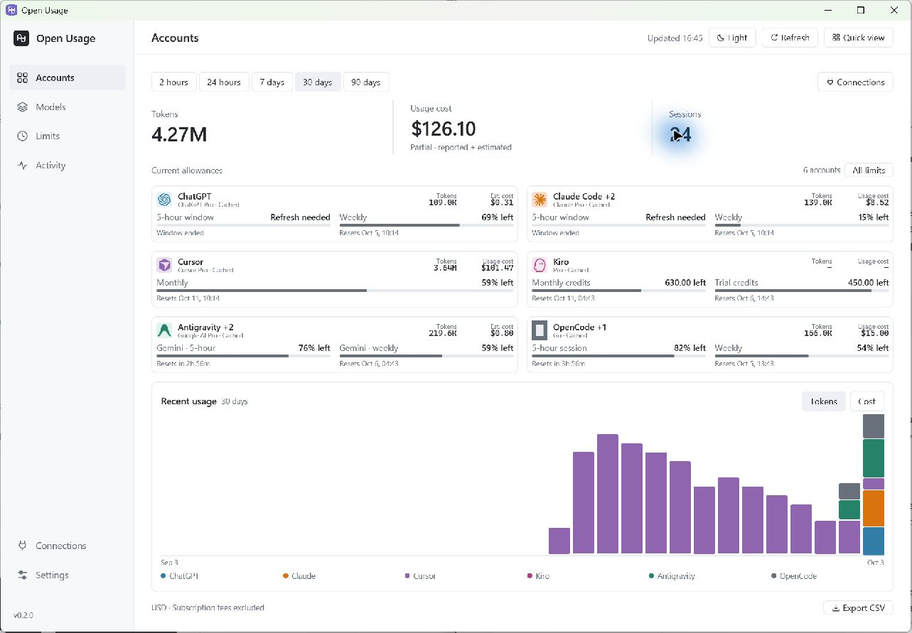

# Open Usage

A native Rust + GPUI app for tracking AI usage, costs, and account limits across ChatGPT (Codex), Claude Code, Cursor, Kiro, Antigravity, and OpenCode.



[Dark theme preview](docs/images/homepage-six-providers-dark.jpg)

## Get started

Download the app from [GitHub Releases](https://github.com/ChiragVijay/open-usage/releases/latest):

| Platform | Download | Install |
| --- | --- | --- |
| Windows x64 | `open-usage.exe` | Save it in a writable folder and run it. |
| macOS 13 or later, Apple Silicon | `open-usage.dmg` | Open the disk image and drag **Open Usage.app** into **Applications**. |

The macOS release supports Apple Silicon only; there is no Intel or universal DMG. Signing and notarization are not configured, so macOS may block the downloaded app. These downloads do not require Rust or the development tools below.

### Build from source

Install Rust **1.97.1** (or run `mise install`), then launch an optimized build:

```sh
cargo run --release --bin open-usage
```

Windows requires Visual Studio Build Tools with Desktop development with C++ and a Windows SDK. macOS requires Xcode command-line tools.

Sign in through your provider's app or CLI. Open Usage discovers existing logins and local history automatically. Use **Connections** to add a data folder or import a Cursor CSV.

| Provider | Connection |
| --- | --- |
| ChatGPT | Codex login and local session history |
| Claude Code | Claude Code OAuth login and local history |
| Cursor | Cursor desktop/CLI login or dashboard CSV |
| Kiro | Kiro CLI or IDE login, including Kiro Crew; usage is reported in credits |
| Antigravity | IDE/`agy` connection or existing OAuth login; local generation history |
| OpenCode | Local Go/Zen history; a Go key supplies account limits |

Kiro credits and Antigravity quotas are verified with Windows CLI logins. OpenCode quota parsing is fixture-tested; its signed-in live checks and macOS execution still need validation.

## Using the app

- **Accounts** shows usage totals, current allowances, reset times, and a usage chart. **Limits** shows every reported allowance.
- **Models**, **Activity**, and **Insights** provide breakdowns. Search and filter tables, click column headings to sort, and export Activity to CSV.
- Choose **2 hours, 24 hours, 7 days, 30 days, or 90 days**. The tray's quick view uses Today.
- Adjust automatic refresh, theme, and display privacy in **Settings**. Display privacy hides figures on screen; CSV exports contain actual values.
- Closing the window keeps tracking active when the tray is available. Use **Ctrl/Cmd + Q** to quit and **Ctrl/Cmd + R** to refresh.

## Updates

On Windows x64 and Apple Silicon Macs, the desktop app checks the latest stable GitHub release once per launch. A newer version offers **Update now** or **Delay**. Downloads and installation begin only when you choose **Update now**; the app then exits so a helper can replace it and relaunch it. **Delay** dismisses the offer for this launch, and the next launch checks again. You can also use **Settings → Updates → Check for updates**.

Keep the Windows executable in a writable folder. On macOS, copy the app out of the DMG before updating. If the installed copy cannot be replaced, the downloaded EXE or DMG is opened for manual installation. Mac replacement prepares the new app on the installation volume and keeps the previous app until replacement succeeds. A failed replacement restores the previous app; if restoration also fails, its backup remains in a folder named `Open Usage.app.update-*` beside the installation.

Intel Mac builds and other architectures do not receive automatic updates. The CLI does not check for app updates.

## Costs and privacy

Costs use provider-reported amounts when available, otherwise public API-rate estimates from [LiteLLM](https://github.com/BerriAI/litellm/blob/main/model_prices_and_context_window.json). Estimates are not subscription bills and exclude subscription fees. Unknown prices stay **-**; Kiro credits stay separate from tokens and dollars. Cached or expired allowances are marked.

History and settings stay on your device. Provider stores are read-only; existing credentials are used for account checks. Prompts, conversations, and usage records are never uploaded. There is no telemetry. Network requests check provider allowances/history, download model prices, and check GitHub releases. Desktop update checks run even when provider online refresh is off; update files are downloaded only after you choose **Update now**.

## CLI

```sh
cargo run --release --no-default-features --bin usage -- --online --period 7d --json
```

Use `--offline --refresh` to read local history and cached allowances. Periods: `2h`, `24h`, `7d`, `30d`, `90d`, or `today`. Run with `--help` for options.

Settings and cache live in `%LOCALAPPDATA%/open-usage` on Windows or `~/Library/Application Support/open-usage` on macOS. `OPEN_USAGE_DATA_DIR` overrides that location.

## Development

```sh
cargo fmt --check
cargo clippy --all-targets -- -D warnings
cargo test --all-targets
cargo run --bin package
```

Packaging creates a release build in `dist/` for the current platform. macOS signing and notarization are not configured.

## Publishing a release

After the **Release** workflow is merged into the default branch:

1. Open **Actions → Release → Run workflow** and select `main`.
2. Choose a `patch`, `minor`, or `major` version bump.
3. Run the workflow. It updates `Cargo.toml` and `Cargo.lock`, commits the version bump to the selected branch, and creates the `vX.Y.Z` tag with a draft GitHub release.
4. Windows and Apple Silicon macOS jobs build that exact commit and upload `open-usage.exe` and `open-usage.dmg`. The Mac job verifies both the Rust host and packaged executable are ARM64 and runs the update-helper regression checks.
5. The publish job verifies both assets exist, then publishes the release so desktop update checks can discover it.

The workflow needs permission to push the version commit and write releases; branch rules must allow that push. If packaging or publication fails, the release stays a draft. Re-run the failed jobs to retry that version rather than starting a new version bump.

## Credits

Built with [GPUI](https://gpui.rs/) and [gpui-component](https://github.com/longbridge/gpui-component). Provider integrations and design reference [OpenUsage](https://github.com/robinebers/openusage), its [Windows fork](https://github.com/mesomya/openusage-windows), [ai-usagebar](https://github.com/akitaonrails/ai-usagebar), and [t3code](https://github.com/pingdotgg/t3code).

Provider SVGs come from OpenUsage and its Windows fork. Their [MIT notice](docs/licenses/OpenUsage-MIT.txt) and [Windows-fork notice](docs/licenses/OpenUsage-Windows-MIT.txt) are included in packaged builds.
