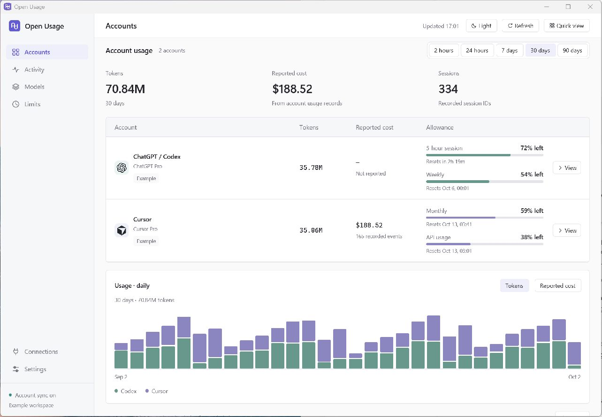
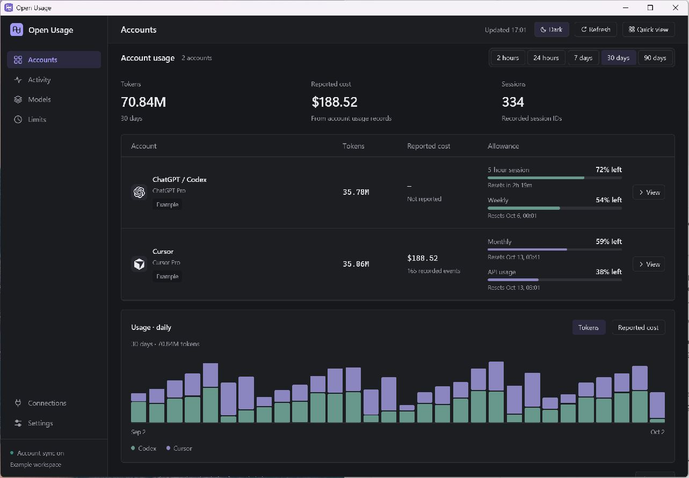

# Open Usage

A native Rust + GPUI app for ChatGPT, Cursor, and Claude Code. It discovers available agents and account history on your machine, then shows tokens, cost, allowances, and reset times by account. Models have a separate page. Compact rows, quiet borders, and a header theme switch support light and dark mode.





## Accounting

A provider-reported dollar amount is used when the account sends one. ChatGPT session logs store tokens and no price, so those rows use public per-token API rates (input, output, cache read, and cache write) from LiteLLM's model table, the same source t3code prices against. The table is cached on this device and downloaded again once a day. That figure is an API-equivalent estimate, not a subscription invoice. A model with no public rate stays **—**. Reported zero remains $0.

- Cursor dashboard history/CSV supplies reported usage cost. Claude models used through Cursor belong to the **Cursor account**. They do not imply a Claude subscription.
- ChatGPT local history supplies tokens. Its account endpoint supplies allowances and reset times. Cost is the public API rate for the recorded model.
- Claude Code's saved `costUSD` is used when present. Streaming message repetitions count once. Records without that field use the public API rate when the model is known. Its account endpoint supplies allowances and reset times.
- Provider-reported usage cost can include usage covered by a plan. It is not a subscription invoice, and does not include the subscription fee.
- The Models page keeps the account attached to each model. The same model used through two accounts remains two rows.
- Codex cumulative counters and Claude streaming blocks are reconciled; cached input is counted once. Incomplete rows are retried. No missing tokens are estimated from conversation text.
- The dashboard supports rolling **2 hours, 24 hours, 7 days, 30 days, and 90 days**. Short views use 5-minute/hourly chart buckets; longer views use daily buckets. The quick view and tray use Today, starting at local midnight. Elapsed ranges remain correct across daylight-saving changes.
- Cached and expired allowances are marked. Expired windows require refresh; quota replenishment is never invented.

The Accounts and tray views include agents with real installation evidence, available history, or an active account connection. A detected agent with no usage shows an empty reading. Missing providers do not get placeholder accounts or statistics.

## Run

Install Rust **1.97.1** or run `mise install`:

```sh
cargo run --bin open-usage
```

Windows requires Visual Studio Build Tools with Desktop development with C++ and a Windows SDK. macOS requires Xcode command-line tools and the macOS SDK. GPUI renders native GPU UI. Longbridge's `gpui-component` 0.5 supplies native controls compatible with GPUI 0.2.2; the application contains no webview or JavaScript runtime.

Mise tasks: `dev`, `check`, `test`, `lint`, `build`, `package`.

## Connections

Agent discovery and local history scanning run automatically. Discovery checks PATH executables, common installation locations, macOS app bundles, standard data folders, environment home overrides, and additional folders you select. It reads filesystem metadata without running agents or exposing credentials. Claude Desktop is not mistaken for Claude Code; unrelated commands named `agent` are not mistaken for Cursor.

New configurations check existing signed-in accounts automatically. **Connections → Account checks** pauses or resumes these reads; existing pause preferences are preserved. Local history continues updating while account checks are paused. No API key is required for subscription logins.

| Account | History | Allowances |
| --- | --- | --- |
| ChatGPT | `CODEX_HOME` or `~/.codex`, including archived sessions | Existing `codex login` |
| Claude Code | `CLAUDE_CONFIG_DIR` or `~/.claude/projects`, including subagents | Claude Code OAuth credentials or macOS Keychain |
| Cursor | Cursor dashboard API, up to 90 days, or a CSV export | Existing Cursor CLI/desktop login |

**Add folder** accepts a provider home such as `.codex`. Additional folders contribute local history; live allowances use the first discoverable login for that provider. Cursor CSV replaces API history to avoid duplication and references the selected file in place.

ChatGPT support means Codex usage associated with the ChatGPT account. Claude support means Claude Code. Cursor account history spans machines; ChatGPT and Claude token histories reflect this device.

Credentials are read only for fixed provider HTTPS endpoints and are never cached, exported, or logged. Requests contain authentication and usage-query parameters; **local history, tokens, session records, prompts, and conversations are never uploaded**. There is no analytics endpoint, cloud database, or external pricing download. macOS Keychain may display its own permission prompt. Expired logins require signing in again using the provider's app or CLI.

## Tray and menu bar

The Windows system tray and macOS menu bar provide:

- Left-click: account quick view.
- Menu: open accounts, quick view, refresh in the background, quit.
- Tooltip: today's tokens and remaining account allowances.
- macOS menu-bar title: remaining account allowances.

Closing the window keeps background tracking active when a tray icon is available. If initialization fails, the app reports the failure in Settings and closing the window quits. **Settings → System tray / Menu bar** reports the actual initialization status.

| Shortcut | Action |
| --- | --- |
| Ctrl/Cmd + 1–6 | Accounts, Activity, Models, Limits, Connections, Settings |
| Ctrl/Cmd + Shift + 1–5 | 2 hours, 24 hours, 7 days, 30 days, 90 days |
| Ctrl/Cmd + R | Refresh |
| Ctrl/Cmd + P | Display privacy mode |
| Ctrl/Cmd + Q | Quit |
| C / T | Reported-cost / token chart |
| L | Limits |
| Tab / Shift+Tab, Enter | Navigate and activate controls |

CSV export respects the selected account and date range. It includes actual metadata while display privacy mode is enabled, and never includes prompts or credentials.

## CLI and storage

```sh
cargo run --no-default-features --bin usage -- --refresh --json
cargo run --no-default-features --bin usage -- --online --days 7
cargo run --no-default-features --bin usage -- --offline --period 2h --json
```

`--online` checks accounts for that invocation without changing preferences; `--offline` reads local history and cached account data. `--period` accepts `2h`, `24h`, `7d`, `30d`, `90d`, and `today`. `--days 1` means the past 24 hours. JSON schema **open-usage.v2** includes the selected period and exact start/end timestamps, account discovery status, summaries, allowances, tokens, models, `reported_usage_cost_usd`, and `usage_cost_usd`. A missing reported cost is `null`. `usage_cost_usd` adds the LiteLLM estimate for rows the account did not price.

Settings and the SQLite metadata cache live in `%LOCALAPPDATA%/open-usage` on Windows and `~/Library/Application Support/open-usage` on macOS. `OPEN_USAGE_DATA_DIR` redirects both for testing. Stored metadata includes source paths, tokens, timestamps and reported usage cost; credentials and conversations are excluded. There is no telemetry or hosted backend.

History scans and account checks run off the UI thread. **Settings → Data → Automatic refresh** defaults to **30 minutes**, with **5 minutes, 10 minutes, 30 minutes, or 1 hour** available. The choice is saved across launches. Existing supported choices are preserved; legacy 1- and 15-minute intervals switch to 30 minutes. Unchanged files reuse normalized cached records; changed files are re-read. Parser upgrades invalidate normalized file caches while preserving account history. Failed checks preserve prior data and mark account readings cached. Existing settings remain compatible; obsolete pricing overrides are ignored.

## Build and verify

```sh
cargo fmt --check
cargo check --all-targets
cargo test --no-default-features
cargo clippy --all-targets -- -D warnings
cargo run --bin package
```

Packaging builds on the current host: `dist/Open Usage-windows/` on Windows, or `dist/Open Usage.app` and `dist/usage` on macOS. macOS signing/notarization are not configured. There are no GitHub Actions.

Windows compilation, the account dashboard, live Codex/Cursor reads, tray initialization, close-to-tray and quick-view sizing have been verified. Claude history and allowance schemas are fixture-tested. macOS execution, Keychain access and a live Claude account still need validation.

## References

[OpenUsage](https://www.openusage.ai/), [t3code's usage documentation](https://github.com/pingdotgg/t3code/blob/54084ae1e6c32809db040e4fa571c80fdf2d8ae4/docs/user/usage.md), and [Longbridge GPUI components](https://github.com/longbridge/gpui-component) inform the design and provider schemas. This is an independent Rust implementation.

The bundled OpenAI, Claude, and Cursor SVG marks come from [OpenUsage's provider icon assets](https://github.com/robinebers/openusage/tree/ae49de04a2b7fc1b3cc334fcc1009276c46d82ad/Sources/OpenUsage/Resources/ProviderIcons). They render locally in account rows, Connections, Limits, and the quick view, with colors suited to each theme.

[t3code's pricing implementation](https://github.com/pingdotgg/t3code/blob/a8927712f8b3338fa3c47a0c657b6e11d7e9aaec/apps/server/src/usage/usagePricing.ts) prefers a provider-reported cost, then prices tokens with LiteLLM's public model table. This app follows that order. The estimate is not a subscription invoice.
